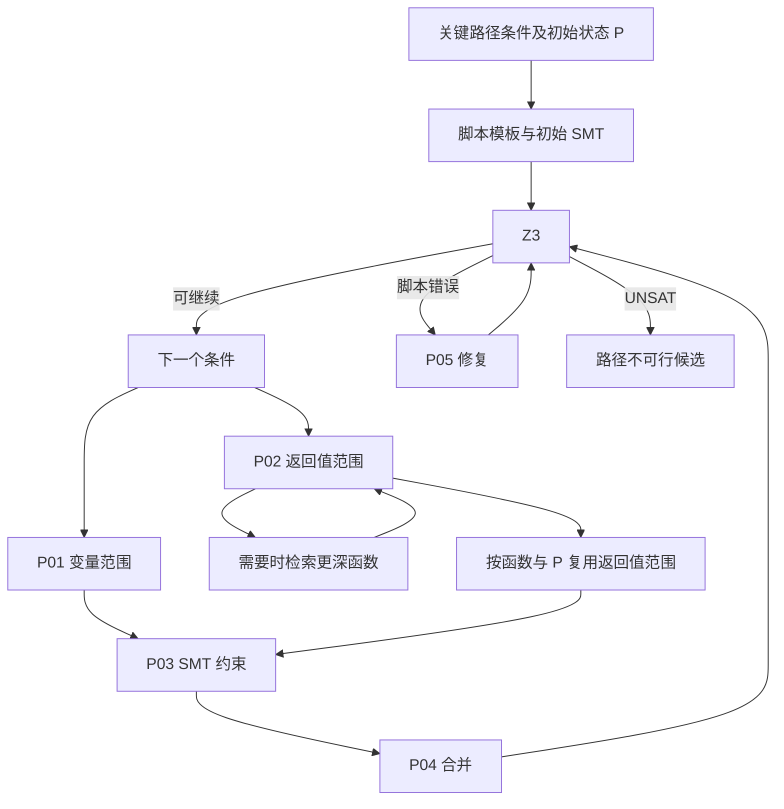

# Prompt 调用顺序还原

本文件为静态调用图，不是执行轨迹。依据冻结上游 `4efb4b9bf7e845e180451b43ba29a25e3edaa0e3`，没有调用模型、启动 MCP 或运行实验。P/U 编号见 [对应表](prompt_mapping.md)。

## 论文描述的逻辑顺序

[PDF pp4–6 §3、Figure 2/3/4](https://arxiv.org/pdf/2506.10322v1#page=4) 描述：输入告警目标变量、Source/Sink 和 Source→Sink 函数链；逐函数提取影响可达性的关键条件与提前退出；构造初始 SMT 并求解；对每个条件进行变量范围或相关函数返回值范围分析，每新增一组范围即转为约束、合并、求解；UNSAT 时提前停止，否则继续下一条件/下一函数。

论文的局部流程可以表示为：

此图表示方法关系，不补写公开缺失的脚本模板、Memory 或调度提示词。上下文最多 5 次、修复最多 3 轮由论文正文规定；Memory 存的是不同 P 下的返回值范围，不是源文件文本缓存。[PDF pp5–6 §3.2.2/3.3](https://arxiv.org/pdf/2506.10322v1#page=5)。原论文使用 Agent 能力描述上下文工具自规划，没有公开多角色协作协议；本阶段保留一个推理主体。

## 冻结公开代码的活动调用顺序

入口 `detect_pipeline()` 遍历数据并调用 `data_flow_analysis_pipeline()`。其内部按程序分支调度，不是由模型自由选择全部步骤。[pipeline:435–461](https://github.com/LLM4PFA/LLM-Enhanced-Path-Feasibility-Analysis/blob/4efb4b9bf7e845e180451b43ba29a25e3edaa0e3/llm4pfa/feasibility_analysis_pipeline.py#L435)。

| 顺序 | 程序行为/提示词 | 消息与输出去向 | 定位 |
|---|---|---|---|
| 0 | 提取关键条件、提前跳转条件；处理 goto/return | 词法提取结果覆盖传入条件；不是提示词 | pipeline:159–170 |
| 1 | U02 get_z3_by_target_conditions | 临时追加 var==0；messages=[user(U02)]；回复记 response_message_target 和 response_list，未追加 assistant | 174–180 |
| 2a | 条件含相关函数：程序先检索函数，再 U04 | message_context=[user(U04)]；调用 without_tool；回复另存 response_list；命中 Not satisfied 直接 False | 190–219 |
| 2b | 其余条件：U05 | 主 messages 中追加 user(U05)，回复追加 assistant；可多次累计；没有每次都转 SMT 和求解 | 223–227 |
| 3 | U06 bug_line_constraints_prompt_step2 | 主 messages 追加 user(U06(base))，承接 2b 的分析；代码解析后形成增量脚本 | 231–233 |
| 4 | U10 get_z3_extract | **新建** messages=[user(U10(U06回复))]；没有单独传入 base；得到 check_constraints 函数 | 236–241 |
| 5 | 执行生成函数、求解；异常时 U01 | 当前主 messages 追加 assistant(失败函数)+user(U01(错误))；再生成、解析、再执行 | 243–272 |
| 6 | 程序构造 !(c1) \|\| !(c2) 等规避条件；U08 筛选相关跳转约束 | 新 messages=[user(U08)]；回复按 json 围栏解析 | 116–125、276–283 |
| 7 | 若筛选后仍有跳转条件：U07 转 SMT | 新 messages=[user(U07)]；上下文函数推理段 287–325 全部注释 | 285–331 |
| 8 | U09 三路合并 | 新 messages=[user(U09(base,target_script,goto_script))]；得到最终函数 | 335–339 |
| 9 | 求解；异常时 U01 | 与步骤 5 类似，但为单独 messages 会话 | 343–372 |
| 10 | 定位下一帧、映射参数，递归上述流程 | 不承接主 messages；response_list 保留日志，非下一帧模型 Memory | 376–433 |

出处：[pipeline:159–272](https://github.com/LLM4PFA/LLM-Enhanced-Path-Feasibility-Analysis/blob/4efb4b9bf7e845e180451b43ba29a25e3edaa0e3/llm4pfa/feasibility_analysis_pipeline.py#L159)、[pipeline:276–433](https://github.com/LLM4PFA/LLM-Enhanced-Path-Feasibility-Analysis/blob/4efb4b9bf7e845e180451b43ba29a25e3edaa0e3/llm4pfa/feasibility_analysis_pipeline.py#L276)。步骤 2–5 仅当 target_conditions 非空；步骤 7–9 仅当过滤后的跳转列表非空。不是所有样本都会经过所有提示词。

### 消息边界对结果的影响

- 初始 U02 回复不是主 messages 的 assistant。U05 看见初始“请求”，未自动看见模型生成的脚本；U06 显式以参数重传该脚本。[pipeline:177–180、224–231](https://github.com/LLM4PFA/LLM-Enhanced-Path-Feasibility-Analysis/blob/4efb4b9bf7e845e180451b43ba29a25e3edaa0e3/llm4pfa/feasibility_analysis_pipeline.py#L177)。
- U04 使用独立 message_context；其自然语言返回值分析没有被规范化为数值范围并合入主 messages。代码只日志记录以及 Not satisfied 子串短路，不能把它画作始终进入 SMT 的范围输出。[pipeline:197–219](https://github.com/LLM4PFA/LLM-Enhanced-Path-Feasibility-Analysis/blob/4efb4b9bf7e845e180451b43ba29a25e3edaa0e3/llm4pfa/feasibility_analysis_pipeline.py#L197)。
- U06 返回值经 process_final_response 后直接传 U10。若它只返回新增约束，U10 新会话没有基础脚本参数；后续只有存在跳转路径时 U09 才显式重合并 base。属于保留约束的风险，不代表本阶段已经测出发生频率。[pipeline:231–240、335](https://github.com/LLM4PFA/LLM-Enhanced-Path-Feasibility-Analysis/blob/4efb4b9bf7e845e180451b43ba29a25e3edaa0e3/llm4pfa/feasibility_analysis_pipeline.py#L231)。
- 原两处 while(cnt<=3) 在开头加一，所以至多 4 次脚本执行；每次失败都可能请求修复，第 4 次失败生成的回复会在下一轮条件退出而未被执行。不能直接等同于“初始一次加三次经验证的修复”。[pipeline:244–272、342–372](https://github.com/LLM4PFA/LLM-Enhanced-Path-Feasibility-Analysis/blob/4efb4b9bf7e845e180451b43ba29a25e3edaa0e3/llm4pfa/feasibility_analysis_pipeline.py#L244)。

### 存在但没有接入主流程的工具循环

`get_answer_from_model_with_tool`（55–84）会读取 tool_calls、取函数体、将带 `name=search_function` 的工具消息追加后递归。主分支真正调用它的第 201 行是注释；活动调用第 206 行为 without_tool。即使只看 helper，它也有公开模板方法名多下划线（73）、工具命名不一致、模型返回 dict/属性接口不一致和 assistant tool_calls 消息封装未追加等缺口。helper 从 iter_num=0 开始，停止条件是 >1，而非正文的 5 次；由于 helper 未接通，不应将该次数当作当前运行设置。[pipeline:55–84、197–206](https://github.com/LLM4PFA/LLM-Enhanced-Path-Feasibility-Analysis/blob/4efb4b9bf7e845e180451b43ba29a25e3edaa0e3/llm4pfa/feasibility_analysis_pipeline.py#L55)。

`result_memory_cache` 的载入与注释检查不足以建立函数返回值语义记忆；同样，函数链列表和 response_list 是程序上下文/日志，不等于 Agent 已拥有长期 Memory。[pipeline:23–28、378](https://github.com/LLM4PFA/LLM-Enhanced-Path-Feasibility-Analysis/blob/4efb4b9bf7e845e180451b43ba29a25e3edaa0e3/llm4pfa/feasibility_analysis_pipeline.py#L23)。

## 补全版增加或替换的调度

主提示词仍来自同一个公开 Prompt 类；不是重新拟定了一套英文文本。[engine:76](../../completion/engine.py#L76)。

| 位置 | 补全版行为 | 对提示词序列的影响 |
|---|---|---|
| engine.py:26–69 | 截取上游 helper/main 函数源码并打补丁 | 不执行上游 batch/imports；不是原文件直接运行 |
| 41、110–130 | 以有时限 worker 替换 exec/check_constraints | 返回值与错误由适配器传回；不增加新英文模板 |
| 43–45 | 修复耗尽后抛出异常 | 最后一次失败不再生成未验证第 4 次修复 |
| 48–50、132–147 | 没有目标/跳转条件时仍 solve_base_query | 增加 **U10(base) → solver → 如有错误 U01** 的调用 |
| 156–161 | 每样本注入依赖、repository.lookup、明确下一帧 | 仍是程序检索，不会自动启用 U04 所写 search_context |
| 99–108、158–159 | 替换代码和 JSON 回复解析器 | 输出接受/报错方式不同，模板文本相同 |

出处：[completion/engine.py:26–76](../../completion/engine.py#L26)、[99–161](../../completion/engine.py#L99)；现有已落盘函数体引用见 [patches/completed_function_bodies.py:140–200、293–333](../../patches/completed_function_bodies.py#L140)，本次仅阅读，未重生成。

当前 Python 模型客户端仅暴露普通 `get_response_with_messages`；提交的 payload 为 messages，没有工具 schema，模型调用由 Python 控制。[completion/model.py:59–91](../../completion/model.py#L59)。将来迁移到 Harness 时应明确迁移这层调度与消息状态，而不是在 Harness 工具里再次嵌套 CompletedEngine 模型循环。

## 与安全策略和 Harness 的边界

原 pipeline 的 False/True 是候选路径判断，不等于安全策略已经批准 FILTER。安全 v1 要求六类证据，异常回退 UNKNOWN/KEEP；本次不更改。[safety/policy.py:13–17、228–242](../../safety/policy.py#L13)。

当前 MCP 只提供上下文与函数源码检索（[server.py:27–40](../../harness_bridge/server.py#L27)），不会执行上述 Prompt 序列，也不提供 SMT/Z3 工具。因此“两个工具能调用”与“论文完整 Agent 流程已运行”是不同的验收项目。
