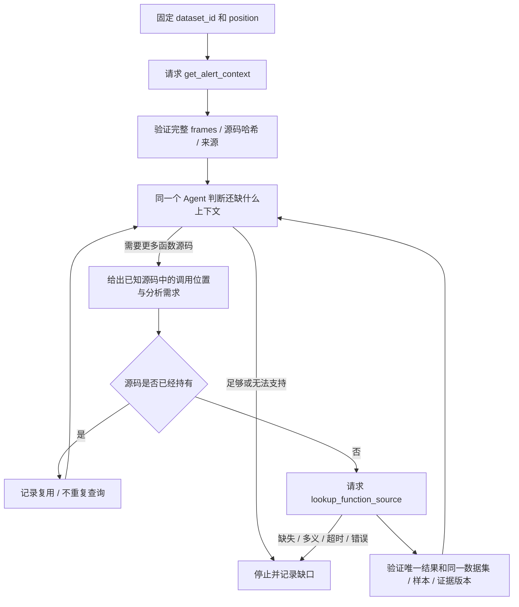

# 单 Agent 上下文检索工作流：第三阶段离线候选

本目录提供 Harness 单推理主体的工作流、独立适配指令和可执行的离线状态机验收。**没有部署或运行 Harness Agent，也没有模型自主选择工具的实测结果。** 测试中的选择由脚本提供，响应来自既有 MCP 记录或明确标注的合成数据。

## 固定基线

- 论文：arXiv:2506.10322v1，pp5–6 §3.2.2/Figure 3、p11 C.1；[PDF](https://arxiv.org/pdf/2506.10322v1#page=6)。
- 官方 checkout：`4efb4b9bf7e845e180451b43ba29a25e3edaa0e3`；不升级 PATHAGENT。
- 提示词审计：发布提交 `68eaa6f6396aa66a6ffaf4c3e7a4af0e4f79ab54`，见 [第二阶段报告](../prompt_audit/prompt_audit_report.md)。
- 检索接口：现有 `get_alert_context`、`lookup_function_source`；MCP 与原代码保持不变。
- 第一阶段 Harness 调用和 Python 18/18 测试成功，作为用户提供的历史状态；本目录没有重新执行第一阶段测试。

起始状态和原文件哈希见 [baseline_snapshot.json](baseline_snapshot.json)。所有新增实现/结果仅位于本目录，不 import 原 pipeline、CompletedEngine、模型客户端、solver、安全策略或 offline_guard。

## 工作流



图中 Agent 的判断是未来 Harness 的工作；当前 `workflow.py` 仅校验外部提供的请求/响应顺序并输出轨迹。它不产生模型回答，也不执行 MCP 请求。`begin()` 和 `lookup()` 返回的 request 对象是离线记录，不是已发送的调用。

初次请求必须是 `get_alert_context(dataset_id, position)`。保留全部 frames、函数链、告警/Sink/变量、源码及来源。后续检索必须引用已持有的调用方源码哈希、函数体内行号和原始行文本，并说明相对于当前分析问题及 P 的检索需要。只进行词法调用候选核对，不声称证明 C 调用绑定、别名或参数状态。

已有源码按定义身份及 `body_sha256` 复用，不能只因同名就替换定义。遇到同名多定义或缺失，停止并记录；不猜测函数体、不扩大数据集、不下载另一个源码版本。所有后续工具请求继续带原 `dataset_id` 和 `position`，尽管现有 lookup schema 本身允许省略 position。

默认最多 **5 次上下文扩展决策**：每次 `lookup()` 提议计一次，包含缓存复用及失败尝试；初次告警上下文请求不计入。真正的 lookup 请求次数单独统计且不超过 5。此计数方式是复现适配的工程约定，不宣称与论文内部 iteration 的计数完全相同。[终止条件](termination_conditions.md) 给出所有停止原因。

## 原文与适配的分离

| 文件 | 身份 |
|---|---|
| [prompts/original_p02.tex](prompts/original_p02.tex) | 论文 p11 的 P02 原始 TeX 块；包含作者的省略号，未补写 |
| [prompts/original_u04.py.txt](prompts/original_u04.py.txt) | 冻结上游 U04 方法源码原样副本，包括 f-string 插槽；仅作为文本，不执行 |
| [prompts/provenance.json](prompts/provenance.json) | 原始文件/片段哈希、行号、来源与归一化说明 |
| [harness_adapter_prompt.md](harness_adapter_prompt.md) | 本项目编写的 Harness 检索适配指令，**不是作者原始 Prompt** |

U04 明确假设指针为 NULL，并要求 Satisfied/Not satisfied/Not sure。它是参考材料，当前只恢复检索，不能用这些标记形成告警裁决；任务未给出 P 时保留未知，不把 NULL 当默认真值。P02 的 `Important: ...` 保持缺失。[作者原文清单](../prompt_audit/paper_prompt_inventory.md)。

## 离线验收

不需要新增依赖。使用已有 Python 3.11.5 和标准库，在 `reproduction` 目录中运行：

```powershell
& C:\Users\22803\anaconda3\python.exe -B agent_reproduction_audit/single_agent_retrieval/test_workflow.py --output-dir agent_reproduction_audit/single_agent_retrieval/results/my_new_offline_run
```

输出目录必须是本目录 `results/` 下尚不存在的新目录；程序拒绝覆盖。测试禁止网络连接和启动子进程，不启动 Harness/MCP，不读取密钥/`.env`。结果包含逐项测试、完整合成/缓存重放轨迹、源码快照、原始测试输出。不要运行已有原项目实验脚本来验收本目录。

最终候选已完成 **25/25 测试**，详见 [acceptance_report.md](acceptance_report.md) 和 [最终测试结果](results/offline_acceptance_04/test_results.json)。初始版本及随后补强的结果也原样保留。三轮合成流程只证明状态机能处理连续回复，不证明 Harness 已自主规划三轮。

## 后续 Harness 使用边界

[task_example.json](task_example.json) 绑定 `codeql_linux` 第 12 行，只是示例任务文件。下一阶段经授权后，向一个 Harness 会话提供任务、适配指令和原文参考，由 Harness 使用真实 MCP 工具；本阶段没有加载这些指令或写入任何 Harness 配置。不能假定配置已经自动强制执行 Python 状态机；当前没有该运行时接线。

消息设计见 [message_state_design.md](message_state_design.md)，名称映射见 [tool_mapping.md](tool_mapping.md)。不提供未经核实的 Harness 配置字段，不创建工具别名或新 MCP 工具。

本目录没有 SMT/Z3、真实缺陷/误报标签处理、预测指标或 FILTER/KEEP 裁决；Function Call Memory 的返回值范围缓存也不在本阶段。检索状态为 `ready/stopped/blocked`，它们都不是告警分类。完成本阶段后停止，不自动启动下一阶段。
