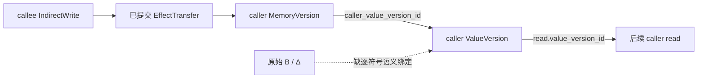

# E06-R05-0：现有证据模块接口审计

日期：2026-11-02，Asia/Shanghai。**接口审计完成；R05 引擎、ConstraintLedger 和本文 Schema 草案均未实现。**

R01–R04 足以只读引用部分受限单次调用、局部值、返回和内存证据，**不足以直接组成经过验证的递归跨过程路径组合器**。缺口包括父子帧边、跨层路径关系、模块间实例身份对照、联合返回与副作用，以及原 B/Δ 到 C 值版本的逐约束绑定。局部 PASS 不能拼成全局证明，不能授权 FILTER。依据见下文实际字段和源码位置。

## 1. 环境、Git 基线与方法

发布克隆 `E:\codexconversation\课题研究\fuxian-github-upload`：分支 main，HEAD **`2889aeec4c955fbf1403c8168e8c219782b77772`**，开始工作区干净，符合指定基线；没有回退、提交、推送或修改 Git 配置。实验源根 `E:\codexconversation\课题研究\reproduction` 本身不是 Git 仓库，只在本审计目录新增文件。

Windows/PowerShell，使用既有 `.venv\Scripts\python.exe -B`。只做标准库读取、JSON 字段/引用核对、Python AST 静态检查及 Git 只读检查。未导入或执行既有分析器/测试运行器、历史脚本、模型生成脚本或 C 程序；未进行 Clang 解析、LLM API/模型/Harness/Z3 调用，未生成 SMT、安装或升级依赖。原文件保护清单含 **6,119** 份非凭据文件，排除 `.git/.venv/__pycache__/node_modules/.env*`，未读取密钥。见[BASE:1](E:/codexconversation/课题研究/reproduction/safety_runs/E06_R05_cross_frame_ledger/audit_baseline.json:1)。

27 个静态索引来源中，26 个项目源码/配置/审计来源与指定 main 的 Git blob 逐字节一致。官方 pipeline 属于独立 upstream Git 仓库，HEAD 为 `4efb4b9bf7e845e180451b43ba29a25e3edaa0e3`，已跟踪工作区干净；本地该文件 CRLF、冻结 blob LF，仅换行不同。原字节 SHA-256 为 `c903f6de291ad4dc0e29ffbfefa7c287d4b92c50d1a7b3febf2661e1a51fb8e3`，冻结 blob 为 `1a2d6d820a09e7e58e727e1a0ddb21b218844592759241a157fc28a7dd87d5f3`。比较时未改文件，不能将文本一致写成原字节一致。首次索引错误假定 upstream 在 main 中，随后原字节相等断言暴露换行差别；查明后记录两种哈希，未运行实验修复结果。详见[IDX:1](E:/codexconversation/课题研究/reproduction/safety_runs/E06_R05_cross_frame_ledger/source_evidence_index.json:1)。

论文仍为 arXiv:2506.10322v1，没有升级 PATHAGENT。须区分官方冻结实现、项目 Engine/E02/E03 补全、独立 R01–R04 安全证据、拟议 R05；本文不宣称严格复现论文全部结果。官方 U06→U10 旧接线和 E03 补全位置分别见[Official:231](E:/codexconversation/课题研究/reproduction/upstream/llm4pfa/feasibility_analysis_pipeline.py:231)、[Engine:69](E:/codexconversation/课题研究/reproduction/completion/engine.py:69)。

| 证据等级 | 本文含义 |
| --- | --- |
| 已实现 | 指定基线源码确有该操作/字段，不自动说明适用于真实告警 |
| 静态确认 | 本轮读代码/配置确认，没有执行其分析逻辑 |
| 既有测试确认 | 读取保存记录确认期望符合，本轮未重跑，不外推为真实传播成功 |
| 尚未验证 | 已查阅证据未证明该组合能力 |
| 缺少证据 | 必需身份/来源/路径/效果缺失，语义关系 UNKNOWN |
| 建议 | 尚未实现，等待下一阶段研究设计确认 |

## 2. R01–R04 实际接口清单

没有统一形式化 JSON Schema。R01/R02 的 config 有 schema_version；R03/R04 主要是普通 dict/list，合同中的 CallerPre/MemoryVersionRecord 等名称多数不是独立类。完整键名样本见[OBS:1](E:/codexconversation/课题研究/reproduction/safety_runs/E06_R05_cross_frame_ledger/saved_evidence_observations.json:1)；静态函数签名与行号见[IDX:1](E:/codexconversation/课题研究/reproduction/safety_runs/E06_R05_cross_frame_ledger/source_evidence_index.json:1)。

| 模块 | 实际公共入口（星号后 keyword-only） | 主要输出 |
| --- | --- | --- |
| R01 | `mapper.analyze(path, *, dataset_id, position, build_status, candidate_source_paths=())` | dataset_id、position、status/reasons、source/source_sha256、build_evidence、diagnostics、macro_expansions、candidate_inventory、calls、elapsed_seconds。[R1:165](E:/codexconversation/课题研究/reproduction/safety_runs/E06_R01_direct_call_argument_mapping/mapper.py:165)[R1:293](E:/codexconversation/课题研究/reproduction/safety_runs/E06_R01_direct_call_argument_mapping/mapper.py:293) |
| R02 | `value_version.analyze(path, *, dataset_id, position, build_status, function=None)` | 来源/状态/诊断及 functions、expression_evidence、scope、SMT_generated、cross_function_state_propagated。指定 function 非唯一则 UNKNOWN。[R2V:315](E:/codexconversation/课题研究/reproduction/safety_runs/E06_R02_local_value_versions/value_version.py:315)[R2V:362](E:/codexconversation/课题研究/reproduction/safety_runs/E06_R02_local_value_versions/value_version.py:362) |
| R03 | `return_transfer.analyze(path, *, dataset_id, position, build_status, caller=None, candidate_source_paths=())` | caller、call_contexts、callees、return_transfers、call_attempts、source_return_inventory、context_isolation、metrics 及来源/状态。[R3T:180](E:/codexconversation/课题研究/reproduction/safety_runs/E06_R03_return_value_transfer/return_transfer.py:180)[R3T:197](E:/codexconversation/课题研究/reproduction/safety_runs/E06_R03_return_value_transfer/return_transfer.py:197) |
| R04 | `indirect_write.analyze(path, *, dataset_id, position, build_status, caller=None, candidate_source_paths=())` | caller、address_evidence、memory_objects、memory_versions、call_contexts、callees、effect_transfers、call_attempts、context_isolation、metrics 及来源/状态。[R4I:238](E:/codexconversation/课题研究/reproduction/safety_runs/E06_R04_restricted_indirect_write/indirect_write.py:238)[R4I:248](E:/codexconversation/课题研究/reproduction/safety_runs/E06_R04_restricted_indirect_write/indirect_write.py:248) |

R03/R04 前置门未通过时 caller=null、证据数组为空；通过后才增加 R01_evidence。输入身份不合法可抛 ValueError，运行异常必须独立记 execution_status，不能算程序语义 REJECT。dataset_id/position 用于命名，不用于样本特判。[R1:173](E:/codexconversation/课题研究/reproduction/safety_runs/E06_R01_direct_call_argument_mapping/mapper.py:173)[R3T:182](E:/codexconversation/课题研究/reproduction/safety_runs/E06_R03_return_value_transfer/return_transfer.py:182)[R4I:240](E:/codexconversation/课题研究/reproduction/safety_runs/E06_R04_restricted_indirect_write/indirect_write.py:240)

四轮只在受控 `synthetic-self-contained` 构建子集可批准；真实 `saved-source-only` 继续 UNKNOWN。build 中 original_project_build_verified=False，不能用恢复 AST 补成真实构建已验证。R03/R04 另检查两次解析 source SHA 一致。[R1:179](E:/codexconversation/课题研究/reproduction/safety_runs/E06_R01_direct_call_argument_mapping/mapper.py:179)[R2A:15](E:/codexconversation/课题研究/reproduction/safety_runs/E06_R02_local_value_versions/r01_adapter.py:15)[R3T:187](E:/codexconversation/课题研究/reproduction/safety_runs/E06_R03_return_value_transfer/return_transfer.py:187)[R3T:207](E:/codexconversation/课题研究/reproduction/safety_runs/E06_R03_return_value_transfer/return_transfer.py:207)[R4I:243](E:/codexconversation/课题研究/reproduction/safety_runs/E06_R04_restricted_indirect_write/indirect_write.py:243)[R4I:253](E:/codexconversation/课题研究/reproduction/safety_runs/E06_R04_restricted_indirect_write/indirect_write.py:253)

候选检查接口分别是 R01.verify_proposal、R02.verify_read_claim/verify_expression_claim、R03/R04.proposal_from/verify_proposal；均不是告警裁决器。[R1:301](E:/codexconversation/课题研究/reproduction/safety_runs/E06_R01_direct_call_argument_mapping/mapper.py:301)[R2V:370](E:/codexconversation/课题研究/reproduction/safety_runs/E06_R02_local_value_versions/value_version.py:370)[R3T:250](E:/codexconversation/课题研究/reproduction/safety_runs/E06_R03_return_value_transfer/return_transfer.py:250)[R4I:287](E:/codexconversation/课题研究/reproduction/safety_runs/E06_R04_restricted_indirect_write/indirect_write.py:287)

## 3. A：R01 调用入口证据

共享 declaration 完整字段为 `name, kind, usr, canonical_location, location, source_range, linkage, declaration_id`。ID 为 `stable_id('decl', [namespace, usr, canonical_location, kind])`，不是函数名或裸 USR。namespace 包含 dataset_id、position、file、source_sha256、build；build 含 flags/状态。location 含 file、一基行列、byte_offset，span 的 end_exclusive 为半开终点。body_sha256 实际哈希 raw(FunctionDecl) 整个函数范围，不可换成只含花括号内部的哈希。[R1:30](E:/codexconversation/课题研究/reproduction/safety_runs/E06_R01_direct_call_argument_mapping/mapper.py:30)[R1:35](E:/codexconversation/课题研究/reproduction/safety_runs/E06_R01_direct_call_argument_mapping/mapper.py:35)[R1:49](E:/codexconversation/课题研究/reproduction/safety_runs/E06_R01_direct_call_argument_mapping/mapper.py:49)[R1:182](E:/codexconversation/课题研究/reproduction/safety_runs/E06_R01_direct_call_argument_mapping/mapper.py:182)[R1:218](E:/codexconversation/课题研究/reproduction/safety_runs/E06_R01_direct_call_argument_mapping/mapper.py:218)

| 对象 | 实际定义与边界 |
| --- | --- |
| Callsite | `stable_id('call', [namespace, span(call), caller.declaration_id])`，词法调用点，不是执行实例。[R1:215](E:/codexconversation/课题研究/reproduction/safety_runs/E06_R01_direct_call_argument_mapping/mapper.py:215) |
| CallRecord | dataset_id、position、callsite_id、caller/callee 声明、callsite、call_text、caller/callee_body_sha256、source_sha256、build_evidence、diagnostics_ref、status/reasons、mappings、ast_is_trusted、scope、reachability_verified、post_call_effects_verified、pointed_object_identity_verified。后三项 False；callee 可 null。[R1:216](E:/codexconversation/课题研究/reproduction/safety_runs/E06_R01_direct_call_argument_mapping/mapper.py:216) |
| Mapping | actual_index_0based、formal_index_0based、actual_expression/source_range/declaration、formal_declaration、actual/formal_slot_id、actual/formal_type、conversion、status/reasons、relation、slot_equivalence=False、value_version_tracking=False、transfer_id。[R1:259](E:/codexconversation/课题研究/reproduction/safety_runs/E06_R01_direct_call_argument_mapping/mapper.py:259) |
| 参数身份 | 按实际参数序号 zip；仅支持标识符/括号包裹的 caller 自动局部或参数。caller-slot 与 callee-slot 是不同角色 ID，不能合并 slot，也不证明 pointee。[R1:144](E:/codexconversation/课题研究/reproduction/safety_runs/E06_R01_direct_call_argument_mapping/mapper.py:144)[R1:266](E:/codexconversation/课题研究/reproduction/safety_runs/E06_R01_direct_call_argument_mapping/mapper.py:266)[R1:282](E:/codexconversation/课题研究/reproduction/safety_runs/E06_R01_direct_call_argument_mapping/mapper.py:282) |
| transfer_id | `stable_id('transfer', [callsite_id, index, actual_slot_id, formal_slot_id])`。不含 caller path、pre-version、context。未知 actual_slot 也可得到 ID；ID 存在不等于 PASS。[R1:284](E:/codexconversation/课题研究/reproduction/safety_runs/E06_R01_direct_call_argument_mapping/mapper.py:284) |
| 类型转换 | conversion 为 actual_type、formal_type、ast_argument_type、kind、status、reasons。type 含 spelling/canonical/kind/size/const/volatile/restrict，pointer 递归 pointee，record 带声明。只支持 identity、signed widening、pointee const addition；const discard 可 REJECT，超范围 UNKNOWN。[R1:60](E:/codexconversation/课题研究/reproduction/safety_runs/E06_R01_direct_call_argument_mapping/mapper.py:60)[R1:80](E:/codexconversation/课题研究/reproduction/safety_runs/E06_R01_direct_call_argument_mapping/mapper.py:80) |

R05 可只读用已验证的 direct-call、声明、源码范围、参数序号、类型转换，但还要绑定 caller 当前值版本和实例。同一 callsite 不同路径可复用同一 R01 transfer_id；已保存 R03 S11 记录中 transfer 相同、context 不同，本轮核对确认。不能把 transfer_id 单独当实例键。[J3Paths:1](E:/codexconversation/课题研究/reproduction/safety_runs/E06_R03_return_value_transfer/synthetic_runs/final_candidate_02/S11_caller_paths.json:1)[OBS:1](E:/codexconversation/课题研究/reproduction/safety_runs/E06_R05_cross_frame_ledger/saved_evidence_observations.json:1)

## 4. B：R02 ValueVersion、读取与路径

基础 ValueVersion 的完整字段如下。R03/R04 继承时才增加 frame_role、call_context_id。[R2V:69](E:/codexconversation/课题研究/reproduction/safety_runs/E06_R02_local_value_versions/value_version.py:69)[R3V:13](E:/codexconversation/课题研究/reproduction/safety_runs/E06_R03_return_value_transfer/return_value.py:13)

```text
dataset_id, position, function_identity, declaration_identity, slot_id,
value_version_id, version_number, display_name, previous_version_id,
definition_event_id, definition_range, raw_assignment, type, assignment_kind, value,
source_slot_id, source_value_version_id, path_id, status, reasons,
reaching_definition_evidence, source_sha256, body_sha256,
memory_object_identity_verified=False, call_effects_verified=False
```

slot_evidence 为 `slot_id, declaration, type, r01_caller_slot_id, r01_callee_slot_id`；local-slot 绑定 namespace 和 declaration_id，callee 角色别名只对形参非空。link_call_reads 先核对 source/data/file 完全一致，再按角色别名、精确范围和 role=call_argument 对接 pre-call read，明确不传播 callee 状态。[R2A:24](E:/codexconversation/课题研究/reproduction/safety_runs/E06_R02_local_value_versions/r01_adapter.py:24)[R2A:33](E:/codexconversation/课题研究/reproduction/safety_runs/E06_R02_local_value_versions/r01_adapter.py:33)

value_version_id 绑定 namespace、slot、path、定义事件和每路径版本号。事件 ID 绑定 namespace、源码范围、path、kind。display_name=x@0/版本号不唯一；previous_version_id 是同 slot 前版本，source_value_version_id 是复制时取到的来源值，两者不同。RHS value_copy 还保留 source_read_id、conversion；后续 p 更新不改变 q 复制的旧值。literal 保留原文及转换，参数入口为 unconstrained_entry_value。[R2V:50](E:/codexconversation/课题研究/reproduction/safety_runs/E06_R02_local_value_versions/value_version.py:50)[R2V:69](E:/codexconversation/课题研究/reproduction/safety_runs/E06_R02_local_value_versions/value_version.py:69)[R2V:175](E:/codexconversation/课题研究/reproduction/safety_runs/E06_R02_local_value_versions/value_version.py:175)[R2V:297](E:/codexconversation/课题研究/reproduction/safety_runs/E06_R02_local_value_versions/value_version.py:297)

Read 完整字段为 `read_id, dataset_id, position, path_id, slot_id, value_version_id, source_range, expression, role, status, reasons, environment_before_read, source_sha256`。从 current[slot] 查已验证版本，reaching_definition_evidence.method 为 ordered_supported_statements_on_one_path。environment_before_read 仅 slot→version 字典，不含完整 guards/memory。[R2V:85](E:/codexconversation/课题研究/reproduction/safety_runs/E06_R02_local_value_versions/value_version.py:85)[R2V:93](E:/codexconversation/课题研究/reproduction/safety_runs/E06_R02_local_value_versions/value_version.py:93)

StateEnvironment 含 path_id、current、counters、guards、termination、invalidated_by；snapshot 不输出 counters。fork deepcopy，不合流。guard 保存 expression、direction、source_range、condition_read_ids、semantics_inferred=False、SMT_generated=False。最多一个 if、两条语法路径，无 phi、无路径可满足性证明。条件 read 可在 fork 前属于父 path，子路径读取也可引用继承的祖先版本，故不能机械要求 read.path_id 等于 version.path_id；需有证据的路径继承。没有通用 parent_path_id，不能反解哈希补边。[R2S:7](E:/codexconversation/课题研究/reproduction/safety_runs/E06_R02_local_value_versions/state_environment.py:7)[R2S:15](E:/codexconversation/课题研究/reproduction/safety_runs/E06_R02_local_value_versions/state_environment.py:15)[R2V:246](E:/codexconversation/课题研究/reproduction/safety_runs/E06_R02_local_value_versions/value_version.py:246)[R2C:1](E:/codexconversation/课题研究/reproduction/safety_runs/E06_R02_local_value_versions/config.json:1)

未知调用、地址逃逸、间接/成员/数组/非局部写等触发 barrier：当前绑定全部置 null，记录前后环境，termination=UNKNOWN_EFFECT_STOP；后续范围为 unprocessed_ranges。不能当“未建模但保持原值”。return 只终止本地路径。[R2V:62](E:/codexconversation/课题研究/reproduction/safety_runs/E06_R02_local_value_versions/value_version.py:62)[R2V:147](E:/codexconversation/课题研究/reproduction/safety_runs/E06_R02_local_value_versions/value_version.py:147)[R2V:218](E:/codexconversation/课题研究/reproduction/safety_runs/E06_R02_local_value_versions/value_version.py:218)[R2V:276](E:/codexconversation/课题研究/reproduction/safety_runs/E06_R02_local_value_versions/value_version.py:276)[R2S:26](E:/codexconversation/课题研究/reproduction/safety_runs/E06_R02_local_value_versions/state_environment.py:26)

**R05 可以原样引用已保存版本，不必重建或修改。** 引用应包含 artifact SHA、JSON Pointer、原 value_version_id；禁止按 display_name 重编号。独立 R02 没有 context 或跨帧边、调用一律 barrier。R03 的跨帧源在 value.caller_pre_value_version_id/argument_transfer_id，R04 在地址/对象/指针记录中，不能把这些误当原 R02 的局部 source_value_version_id。[R2V:88](E:/codexconversation/课题研究/reproduction/safety_runs/E06_R02_local_value_versions/value_version.py:88)[R3V:115](E:/codexconversation/课题研究/reproduction/safety_runs/E06_R03_return_value_transfer/return_value.py:115)[R4I:98](E:/codexconversation/课题研究/reproduction/safety_runs/E06_R04_restricted_indirect_write/indirect_write.py:98)

## 5. C：R03 返回值与调用实例

| 研究概念 | 实际保存结构 |
| --- | --- |
| CallerPre | context/transfer.caller_pre_environment，argument_records[].caller_pre_slot_id/caller_pre_version；不是独立类。[R3T:40](E:/codexconversation/课题研究/reproduction/safety_runs/E06_R03_return_value_transfer/return_transfer.py:40)[R3T:85](E:/codexconversation/课题研究/reproduction/safety_runs/E06_R03_return_value_transfer/return_transfer.py:85) |
| ArgumentTransfer | argument_transfer_id（复用 R01 transfer）、两个序号、caller_pre_slot/version、r01_actual/formal_slot_id、formal_declaration_offset、type_compatibility、actual/formal_source_range、status。[R3T:85](E:/codexconversation/课题研究/reproduction/safety_runs/E06_R03_return_value_transfer/return_transfer.py:85) |
| CallContext | call_context_id、dataset/position、caller/callee_function_identity、两端 body SHA、source SHA、callsite_id/range、caller_path_id、caller_pre_environment、parameter_mapping_records、callee_entry_bindings、summary_cache_used、callee_state_reused、status，后附 result_disposition。没有 parent_context_id/parent_frame_id。[R3C:6](E:/codexconversation/课题研究/reproduction/safety_runs/E06_R03_return_value_transfer/call_context.py:6) |
| CalleeEntry | callee namespace 加 call_context_id/frame_role；value.kind=argument_transfer，含 caller_pre_value_version_id/caller_pre_slot_id/conversion。entry bindings 含 argument_transfer_id、caller pre、callee_entry_version/slot、formal offset、slots_merged=False、status。[R3T:97](E:/codexconversation/课题研究/reproduction/safety_runs/E06_R03_return_value_transfer/return_transfer.py:97)[R3V:108](E:/codexconversation/课题研究/reproduction/safety_runs/E06_R03_return_value_transfer/return_value.py:108) |
| CalleeReturn | return_values[] 含 dataset/position、两端 function identity、call_context_id/callsite_id、callee_path_id/frame_role、return_event_id/source_range/raw expression/type/category、source_slot/version、callee_current_versions、return_guard、source/body SHA、status/reasons/type_compatibility、return_value_id。变量返回才有 source_read_id，常量才有 literal；void 的 return_value_id=null。[R3V:18](E:/codexconversation/课题研究/reproduction/safety_runs/E06_R03_return_value_transfer/return_value.py:18) |
| PathReturn | path_id、guard、return_event_id/value_id、normal_return、can_continue_caller、status/reasons、call_context_id；callee report 有 return_path_completeness/call_effect_coverage。[R3V:80](E:/codexconversation/课题研究/reproduction/safety_runs/E06_R03_return_value_transfer/return_value.py:80)[R3V:141](E:/codexconversation/课题研究/reproduction/safety_runs/E06_R03_return_value_transfer/return_value.py:141) |
| CallerPost | transfer 的 caller_result_slot_id/version_id、caller_post_path_id/environment；evidence_chain.caller_post 指接收值。新版本 value.kind=call_return，引用 context、return_transfer_id、callee_return_value_id。[R3T:123](E:/codexconversation/课题研究/reproduction/safety_runs/E06_R03_return_value_transfer/return_transfer.py:123)[R3T:154](E:/codexconversation/课题研究/reproduction/safety_runs/E06_R03_return_value_transfer/return_transfer.py:154) |

ReturnTransfer 还保存 caller_pre_version[]、argument_transfer_id[]、callee_entry_version[]、callee_return_value_id、callee_path_id、return_event_id、接收/忽略/void 标志、type_compatibility、各分项状态、source/body SHA、evidence_chain、return_transfer_id。**实际没有统一名为 return_binding 或 caller_result 的对象**，有的是 return_binding_status 与 caller_result_*。[R3T:123](E:/codexconversation/课题研究/reproduction/safety_runs/E06_R03_return_value_transfer/return_transfer.py:123)

return_binding_status=PASS 只验证某条 callee 返回表达式。caller_result_status=PASS 还要求所有相关返回路径/效果完整、合法接收目标和转换通过，才建 caller 新版本；局部返回 PASS 可与全调用 UNKNOWN 并存。忽略非 void 返回仍保存 ReturnValue，return_value_ignored=True、result_disposition=ignored、caller_result_status=N/A、接收 slot/version=null；void 单独用 void_normal_return，不等同 ignored。[R3T:111](E:/codexconversation/课题研究/reproduction/safety_runs/E06_R03_return_value_transfer/return_transfer.py:111)[R3T:140](E:/codexconversation/课题研究/reproduction/safety_runs/E06_R03_return_value_transfer/return_transfer.py:140)[R3Test:90](E:/codexconversation/课题研究/reproduction/safety_runs/E06_R03_return_value_transfer/test_return_transfer.py:90)

支持子集内，return/context/callee path 精确配对到 caller post；S07 后续读取指向 received version，S04 两个 return 对应两个不同 post 版本，无 phi，S08 忽略返回没有伪造结果值。已实现并由既有合成测试、保存字段确认。[J3Read:1](E:/codexconversation/课题研究/reproduction/safety_runs/E06_R03_return_value_transfer/synthetic_runs/final_candidate_02/S07_read.json:1)[J3Returns:1](E:/codexconversation/课题研究/reproduction/safety_runs/E06_R03_return_value_transfer/synthetic_runs/final_candidate_02/S04_two_returns.json:1)[J3Ignored:1](E:/codexconversation/课题研究/reproduction/safety_runs/E06_R03_return_value_transfer/synthetic_runs/final_candidate_02/S08_ignored.json:1)[R3Test:95](E:/codexconversation/课题研究/reproduction/safety_runs/E06_R03_return_value_transfer/test_return_transfer.py:95)

**不能直接递归组合嵌套调用。** callee 是 ReturnTrace，不是可 invoke 的 CallerTrace；return f() 显式不递归，callee 普通 call 继承 R02 barrier。S12_nested_return 已保存 UNKNOWN。context 保存父 path/pre/guards，但 callee 初始化新环境，不注入父 guards；callee return_guard 保留在证据，caller post 复制原 caller guards，guard_transferred_to_caller=False、path_satisfiability_proven=False。S04 的 callee guard 非空、caller post guard 为空，本轮已核对。[R3T:98](E:/codexconversation/课题研究/reproduction/safety_runs/E06_R03_return_value_transfer/return_transfer.py:98)[R3V:71](E:/codexconversation/课题研究/reproduction/safety_runs/E06_R03_return_value_transfer/return_value.py:71)[R3V:95](E:/codexconversation/课题研究/reproduction/safety_runs/E06_R03_return_value_transfer/return_value.py:95)[R3T:151](E:/codexconversation/课题研究/reproduction/safety_runs/E06_R03_return_value_transfer/return_transfer.py:151)[J3Nested:1](E:/codexconversation/课题研究/reproduction/safety_runs/E06_R03_return_value_transfer/synthetic_runs/final_candidate_02/S12_nested_return.json:1)[J3Returns:1](E:/codexconversation/课题研究/reproduction/safety_runs/E06_R03_return_value_transfer/synthetic_runs/final_candidate_02/S04_two_returns.json:1)

create_context 先哈希 payload，随后追加 entry bindings、更新 status/disposition，不是 frozen object，也不是最终整个 JSON 的内容哈希。R05 应引用最终 artifact SHA，不能共享并修改现场 dict。caller 接收版本顶层 call_context_id 表示所属帧，根 caller 为 null；value.call_context_id 表示产生该值的调用，不能互相补写。[R3C:6](E:/codexconversation/课题研究/reproduction/safety_runs/E06_R03_return_value_transfer/call_context.py:6)[R3V:13](E:/codexconversation/课题研究/reproduction/safety_runs/E06_R03_return_value_transfer/return_value.py:13)[R3V:121](E:/codexconversation/课题研究/reproduction/safety_runs/E06_R03_return_value_transfer/return_value.py:121)[R3T:160](E:/codexconversation/课题研究/reproduction/safety_runs/E06_R03_return_value_transfer/return_transfer.py:160)[R3T:168](E:/codexconversation/课题研究/reproduction/safety_runs/E06_R03_return_value_transfer/return_transfer.py:168)

## 6. D：R04 内存对象、副作用与桥接

| 结构 | 实际字段与边界 |
| --- | --- |
| AddressEvidence | address_evidence_id、dataset/position、callsite_id、caller_path_id、original_expression、source_location、source_sha256、caller_body_sha256、target_memory_object_id、caller_slot_id、declaration_identity、caller_pre_version、type_compatibility、status/unknown_reason。caller_pre_version 是对象原内容值，**不是地址值**。[R4P:5](E:/codexconversation/课题研究/reproduction/safety_runs/E06_R04_restricted_indirect_write/pointer_target.py:5) |
| MemoryObject | memory_object_id、dataset/position、owning_function、declaration_identity、caller_slot_id、object_type/scope、source_location、body/source SHA、storage_kind、escape_status、status/unknown_reason、unique_by。同对象多次调用不造新对象；不等于 pointer slot。[R4M:9](E:/codexconversation/课题研究/reproduction/safety_runs/E06_R04_restricted_indirect_write/memory_object.py:9) |
| PointerTarget | pointer_target_id、pointer_slot_id/value_version_id、target_memory_object_id/address_evidence_id、call_context_id、caller_path_id、callee_entry_version_id、type_compatibility、uniqueness_status、source_location、parameter_identity、status/relation、slots_merged=False。仅对入口指针值有效。[R4P:37](E:/codexconversation/课题研究/reproduction/safety_runs/E06_R04_restricted_indirect_write/pointer_target.py:37) |
| MemoryVersion | memory_object_id、memory_version_id、previous_memory_version_id、caller_value_version_id、write_event_id、kind、write_value/type、call_context_id、path_id、source_location、body/source SHA、status/unknown_reason。dataset/position 需经 object/report 追溯。初始 snapshot 不算写。[R4M:22](E:/codexconversation/课题研究/reproduction/safety_runs/E06_R04_restricted_indirect_write/memory_object.py:22) |
| IndirectWrite | indirect_write_id、caller_pre_version、target_memory_object_id、pointer_parameter_identity、pointer_slot_id、pointer_entry/current_version、indirect_write_location、original_expression、write_event_id、assigned_value/type、type_compatibility、callee_body_sha256、call_context_id、callee_path_id、caller_post_version/memory_version、effect_coverage、source_evidence、status/reasons。[R4I:53](E:/codexconversation/课题研究/reproduction/safety_runs/E06_R04_restricted_indirect_write/indirect_write.py:53) |
| EffectTransfer | effect_transfer_id、context/callsite/object/address/argument/pointer IDs、caller_pre/post_version、caller_pre/post_memory_version、caller_pre/post_environment、indirect_write_ids、effect/escape_coverage、unknown_effect_block_status、caller_new_version_status、pointer_entry/unique_target_status、status/reasons、source/caller/callee SHA、evidence_chain。无独立 caller_post_path_id，路径在 post_environment.path_id。[R4I:202](E:/codexconversation/课题研究/reproduction/safety_runs/E06_R04_restricted_indirect_write/indirect_write.py:202) |
| 逃逸/未知事件 | escape_event_id、source_location、original_expression、reason、status=UNKNOWN、call_context_id；一些不支持操作只产生通用 unknown_effect_barrier，不保证每个未知原因都有 escape_event。[R4I:18](E:/codexconversation/课题研究/reproduction/safety_runs/E06_R04_restricted_indirect_write/indirect_write.py:18)[R4I:49](E:/codexconversation/课题研究/reproduction/safety_runs/E06_R04_restricted_indirect_write/indirect_write.py:49)[R4I:136](E:/codexconversation/课题研究/reproduction/safety_runs/E06_R04_restricted_indirect_write/indirect_write.py:136) |

R04 参数记录使用新的 address-transfer ID，并保留 R01_original_transfer_id、address/object、caller pre 内容值/slot、formal_declaration、type_compatibility、value_category=address_of_object。R03 参数记录则含序号/formal offset、代表值复制；两者 Schema 与语义不同。R04 entry_kind=address_not_scalar_value_equality，不能写 p_entry=x_pre。[R4I:191](E:/codexconversation/课题研究/reproduction/safety_runs/E06_R04_restricted_indirect_write/indirect_write.py:191)[R4I:103](E:/codexconversation/课题研究/reproduction/safety_runs/E06_R04_restricted_indirect_write/indirect_write.py:103)[R3T:85](E:/codexconversation/课题研究/reproduction/safety_runs/E06_R03_return_value_transfer/return_transfer.py:85)

R01 对 &x 的原 mapping 仍 UNKNOWN；R04 仅在其唯一缺口恰为 actual_expression_outside_identifier_subset 时复用 direct-call/唯一定义事实，独立证明取址，不改原 R01 状态。[R4A:27](E:/codexconversation/课题研究/reproduction/safety_runs/E06_R04_restricted_indirect_write/r03_adapter.py:27)[R4I:178](E:/codexconversation/课题研究/reproduction/safety_runs/E06_R04_restricted_indirect_write/indirect_write.py:178)

### 6.1 同一 R04 报告内已有可靠桥接

**可以桥接，不必新造一个 R02 版本。** R04 完整调用后通过继承的版本生成器创建 caller ValueVersion，同时 MemoryStore.version 显式记录 caller_value_version_id。[R4I:141](E:/codexconversation/课题研究/reproduction/safety_runs/E06_R04_restricted_indirect_write/indirect_write.py:141)[R4I:219](E:/codexconversation/课题研究/reproduction/safety_runs/E06_R04_restricted_indirect_write/indirect_write.py:219)[R4M:22](E:/codexconversation/课题研究/reproduction/safety_runs/E06_R04_restricted_indirect_write/memory_object.py:22)



安全桥接需核对：

1. address→object→caller_slot/声明、source/body/type 一致；context、pointer target、write、transfer 的对象和入口指针版本一致。
2. transfer/effect/escape/正常返回覆盖完整；局部 write PASS、全效果 UNKNOWN 不可提交。
3. pre_environment 的值/内存与 caller_pre_version/memory_version 一致。
4. `memory_version_id=transfer.caller_post_memory_version` 且 `caller_value_version_id=transfer.caller_post_version`；值版本 slot 等于 object.caller_slot_id。
5. 新值 previous、新内存 previous、实际 write_event、转换和旧版本链对应，旧值保留。
6. post_environment 同时绑定新值和新内存；后续 read 引用可靠 reaching definition，或有明确复制/后续赋值链；同一 continuation 或有证据的路径继承，期间无失效/越出作用域。

S02_read 的保存字段明确满足 `effect_transfers[0].caller_post_version = memory_versions[1].caller_value_version_id = caller.reads[0].value_version_id`，object/slot/post path 对应。本轮只核对保存字段，既有 S02_read_latest 与原 audit 也覆盖该链。具体完整 ID、哈希、JSON Pointer 见 observations。[J4Read:1](E:/codexconversation/课题研究/reproduction/safety_runs/E06_R04_restricted_indirect_write/synthetic_runs/final_candidate_01/S02_read.json:1)[R4Test:46](E:/codexconversation/课题研究/reproduction/safety_runs/E06_R04_restricted_indirect_write/test_indirect_write.py:46)[R4Audit:40](E:/codexconversation/课题研究/reproduction/safety_runs/E06_R04_restricted_indirect_write/audit_evidence.py:40)[OBS:1](E:/codexconversation/课题研究/reproduction/safety_runs/E06_R05_cross_frame_ledger/saved_evidence_observations.json:1)

### 6.2 不等于通用跨帧内存传播

- **独立 R02 输出不能直接接上。** R02 普通调用 barrier，root path-entry；R03/R04 root 为 r03-path-entry，再建特定 post path。即使 slot 有角色对照，version 的 path/event/namespace 不同，不能按变量名、literal 或行号合并。[R2V:147](E:/codexconversation/课题研究/reproduction/safety_runs/E06_R02_local_value_versions/value_version.py:147)[R2V:297](E:/codexconversation/课题研究/reproduction/safety_runs/E06_R02_local_value_versions/value_version.py:297)[R3V:95](E:/codexconversation/课题研究/reproduction/safety_runs/E06_R03_return_value_transfer/return_value.py:95)[R4I:221](E:/codexconversation/课题研究/reproduction/safety_runs/E06_R04_restricted_indirect_write/indirect_write.py:221)
- **跨报告/嵌套桥缺字段。** 缺显式 owning_frame_instance_id、parent_context_ref、统一 namespace_ref、词法声明↔实例声明对照、path predecessor 和完整可恢复 memory 环境。需在新 sidecar 补“引用和证明”，不是修改旧版本。不同 TU/build、递归帧、别名关系不足时 UNKNOWN。[R3C:6](E:/codexconversation/课题研究/reproduction/safety_runs/E06_R03_return_value_transfer/call_context.py:6)[R4M:12](E:/codexconversation/课题研究/reproduction/safety_runs/E06_R04_restricted_indirect_write/memory_object.py:12)[R4I:238](E:/codexconversation/课题研究/reproduction/safety_runs/E06_R04_restricted_indirect_write/indirect_write.py:238)
- **generic 快照不含 memory_current。** R04 调用前后/barrier 使用扩展 snapshot，但继承的 caller.state_snapshots/final_environments 仍调用 R02 snapshot，不含内存。不能从缺字段推断空内存或按列表最后版本恢复所有路径。本轮 S02 保存记录确认此差异。[R4A:15](E:/codexconversation/课题研究/reproduction/safety_runs/E06_R04_restricted_indirect_write/r03_adapter.py:15)[R2S:33](E:/codexconversation/课题研究/reproduction/safety_runs/E06_R02_local_value_versions/state_environment.py:33)[R2V:290](E:/codexconversation/课题研究/reproduction/safety_runs/E06_R02_local_value_versions/value_version.py:290)[R3V:147](E:/codexconversation/课题研究/reproduction/safety_runs/E06_R03_return_value_transfer/return_value.py:147)[OBS:1](E:/codexconversation/课题研究/reproduction/safety_runs/E06_R05_cross_frame_ledger/saved_evidence_observations.json:1)
- **局部重绑与写入不同。** p=0 只更新 callee pointer，不造 caller 新值/内存；先写再重绑保留写入，先重绑再解引用不能复用入口 target。已实现及既有测试确认。[R4I:43](E:/codexconversation/课题研究/reproduction/safety_runs/E06_R04_restricted_indirect_write/indirect_write.py:43)[R4I:65](E:/codexconversation/课题研究/reproduction/safety_runs/E06_R04_restricted_indirect_write/indirect_write.py:65)[J4Rebind:1](E:/codexconversation/课题研究/reproduction/safety_runs/E06_R04_restricted_indirect_write/synthetic_runs/final_candidate_01/S04_rebind.json:1)[R4Test:50](E:/codexconversation/课题研究/reproduction/safety_runs/E06_R04_restricted_indirect_write/test_indirect_write.py:50)
- **多次写入限多次独立受限调用。** X_same_object_twice 对象相同、context 不同，第二次 pre memory/value 精确等于第一次 post。单个 callee 第二次 store UNKNOWN；S24 首条 write PASS 但 effect UNKNOWN、caller post=null，不能提交前缀。[J4Twice:1](E:/codexconversation/课题研究/reproduction/safety_runs/E06_R04_restricted_indirect_write/synthetic_runs/final_candidate_01/X_same_object_twice.json:1)[J4TwoWrites:1](E:/codexconversation/课题研究/reproduction/safety_runs/E06_R04_restricted_indirect_write/synthetic_runs/final_candidate_01/S24_two_writes.json:1)[R4I:66](E:/codexconversation/课题研究/reproduction/safety_runs/E06_R04_restricted_indirect_write/indirect_write.py:66)
- **写来源与对象归属分开。** caller ValueVersion.definition_range 是 callsite；MemoryVersion.source_location/body_sha256 在间接写时可指 callee，source_sha256 是该同一 TU。目标声明走 object，写来源走 write/context，不能把写位置当 caller 本地定义位置。[R4I:148](E:/codexconversation/课题研究/reproduction/safety_runs/E06_R04_restricted_indirect_write/indirect_write.py:148)[R4I:224](E:/codexconversation/课题研究/reproduction/safety_runs/E06_R04_restricted_indirect_write/indirect_write.py:224)[R4M:31](E:/codexconversation/课题研究/reproduction/safety_runs/E06_R04_restricted_indirect_write/memory_object.py:31)

## 7. E：B/Δ 原始存储与来源追溯

官方 U02 response_message_target 是 B，临时加入 var_name==0 作为缺陷查询目标，所以 B 不应统称纯控制流 guard。U06 bug_line_constraints_response 是 Δ；旧 U10 只收到解析后的 Δ。项目 E03 保留两段原字符串、确定性拼接并做 E02 结构检查，属于项目补全。[Official:173](E:/codexconversation/课题研究/reproduction/upstream/llm4pfa/feasibility_analysis_pipeline.py:173)[Official:231](E:/codexconversation/课题研究/reproduction/upstream/llm4pfa/feasibility_analysis_pipeline.py:231)[Engine:69](E:/codexconversation/课题研究/reproduction/completion/engine.py:69)[CB:103](E:/codexconversation/课题研究/reproduction/completion/constraint_bundle.py:103)

| 层次 | 实际内容 |
| --- | --- |
| 模型调用记录 | call_id、sample_id、messages、parameters、choices、usage 等；原文本在 choices[0].message.content。本轮确认 A04 calls/0231 与保存 bundle.base.raw_text 相同，不执行其脚本。[JCall:1](E:/codexconversation/课题研究/reproduction/safety_runs/E03_base_delta_explicit_transfer_fix/evidence/A04/calls/0231.json:1)[OBS:1](E:/codexconversation/课题研究/reproduction/safety_runs/E06_R05_cross_frame_ledger/saved_evidence_observations.json:1) |
| E03 bundle | adapter_version、base/delta、merged_script、base/delta/merged_sha256、assembly_audit。每段含 stage、reference、raw_text/raw_sha256、provenance_scope、code_text/code_sha256、merged_span。[CB:50](E:/codexconversation/课题研究/reproduction/completion/constraint_bundle.py:50)[CB:125](E:/codexconversation/课题研究/reproduction/completion/constraint_bundle.py:125) |
| 区间 | merged_span.start/end 是 Python character offset、半开；不是 UTF-8 byte offset/C 范围。原围栏响应与解码代码哈希分别保存。[CB:117](E:/codexconversation/课题研究/reproduction/completion/constraint_bundle.py:117)[CB:129](E:/codexconversation/课题研究/reproduction/completion/constraint_bundle.py:129) |
| Engine 来源 envelope | event_id 是 sample 内事件序号；sample_position、frame_level、dataset、sample_id；reference=position/.../frame/.../U02或U06/raw_response。没有 R03 context 或 R01 声明 ID。[Engine:214](E:/codexconversation/课题研究/reproduction/completion/engine.py:214)[Engine:227](E:/codexconversation/课题研究/reproduction/completion/engine.py:227) |
| E02 IR | declarations、assertions、bindings、issues、snapshots、resets、source。declaration=symbol/sort/origin；assertion=formula/origin，Python 另含 solver；bindings=python_name/symbol/sort/origin。[E2:169](E:/codexconversation/课题研究/reproduction/safety_runs/E02_base_constraint_preservation_static/checker.py:169)[E2:205](E:/codexconversation/课题研究/reproduction/safety_runs/E02_base_constraint_preservation_static/checker.py:205)[E2:329](E:/codexconversation/课题研究/reproduction/safety_runs/E02_base_constraint_preservation_static/checker.py:329)[E2:378](E:/codexconversation/课题研究/reproduction/safety_runs/E02_base_constraint_preservation_static/checker.py:378) |
| 每条 origin | SMT：reference、command_index、source_sha256；Python：reference、line、source_sha256。line 是解码后模型脚本行，SHA 是脚本来源，不是 C 函数哈希。[E2:197](E:/codexconversation/课题研究/reproduction/safety_runs/E02_base_constraint_preservation_static/checker.py:197)[E2:261](E:/codexconversation/课题研究/reproduction/safety_runs/E02_base_constraint_preservation_static/checker.py:261) |
| 检查状态 | contract_status、accepted/rejection_reasons、counts、check_contract、sources；semantic_correctness/polarity_correctness=NOT_ASSESSED，alert_safety_decision=null、solver_executed=False。[CB:90](E:/codexconversation/课题研究/reproduction/completion/constraint_bundle.py:90) |

**已经能够保留：** 原响应→调用记录/sample/frame envelope→raw/code SHA→合并字符区间→脚本 assertion 的结构来源。保存 merge_audit 还列 source_files 原调用路径/哈希/副本；本轮检查 A01/A04 的四段 raw/code 哈希和区间、8 份调用副本。示例 event 的 B assertion origin 是 position/12/frame/1/U02/raw_response 第3行，不是 C 第3行。[JMerge:1](E:/codexconversation/课题研究/reproduction/safety_runs/E03_base_delta_explicit_transfer_fix/merge_audit.json:1)[JEvent:1](E:/codexconversation/课题研究/reproduction/safety_runs/E03_base_delta_explicit_transfer_fix/engine_traces/A04/constraint_transfer_e03/001.json:1)[OBS:1](E:/codexconversation/课题研究/reproduction/safety_runs/E06_R05_cross_frame_ledger/saved_evidence_observations.json:1)

**缺少：** 每个 assertion 的 C 文件/函数声明/AST 范围与哈希、symbol→slot/value/memory version、call_context/path、已验证极性，以及 frame_level→R05 实例的对照。Python bindings 不是 C 变量绑定。reference 可为默认 caller_supplied 字符串，非空不等于独立取证。**原字节/脚本来源可完整保留，跨帧 C 状态语义来源不完整。**[CB:50](E:/codexconversation/课题研究/reproduction/completion/constraint_bundle.py:50)[E2:261](E:/codexconversation/课题研究/reproduction/safety_runs/E02_base_constraint_preservation_static/checker.py:261)[Engine:214](E:/codexconversation/课题研究/reproduction/completion/engine.py:214)

建议 R05 只读 ConstraintRef：artifact path/hash/JSON Pointer、原 role、raw/code SHA、reference、script line/command index、occurrence 序号、原 formula/状态引用。实际空 Δ 与缺失 Δ 分开；重复断言各占 occurrence；不覆盖、重命名、简化、去重或执行原脚本。E02 IR 会围绕最后 syntactic query 选择断言，不能只保留该 IR 而丢 raw/snapshots/resets。[E2:223](E:/codexconversation/课题研究/reproduction/safety_runs/E02_base_constraint_preservation_static/checker.py:223)[E2:240](E:/codexconversation/课题研究/reproduction/safety_runs/E02_base_constraint_preservation_static/checker.py:240)[E2:333](E:/codexconversation/课题研究/reproduction/safety_runs/E02_base_constraint_preservation_static/checker.py:333)[E2:487](E:/codexconversation/课题研究/reproduction/safety_runs/E02_base_constraint_preservation_static/checker.py:487)

另建候选 ConstraintBinding：每个符号 occurrence→声明/版本/帧/路径/极性/类型证据，缺项保留 UNKNOWN。不得据此导出新求解约束。A01 copied 极性、E04-ND 的 skb->len 被替为 skb、A04 object/object_ptr/object_bv 及 B/Δ 丢失风险均须保留，不能用改名或“最后一次赋值”洗成 PASS。[E05:21](E:/codexconversation/课题研究/reproduction/safety_runs/E05_polarity_variable_identity/source_review.md:21)[E05:23](E:/codexconversation/课题研究/reproduction/safety_runs/E05_polarity_variable_identity/source_review.md:23)[JMerge:1](E:/codexconversation/课题研究/reproduction/safety_runs/E03_base_delta_explicit_transfer_fix/merge_audit.json:1)[Design:74](E:/codexconversation/课题研究/reproduction/safety_runs/E06_design/E06_technical_design.md:74)

## 8. F：统一身份和状态兼容性

| 目标字段 | 现状 / R05 建议 |
| --- | --- |
| sample_id | 核心 analyze 只有 dataset_id/position；sample_id 在 runner envelope。固定清单 row_position→position，kernel69 的 dataset_id 使用 linux 命名；不能拿 index 替代。保留 manifest/数据集哈希与原映射。[R3Run:38](E:/codexconversation/课题研究/reproduction/safety_runs/E06_R03_return_value_transfer/run_r03.py:38) |
| function_decl_id | 无此同名字段，实际是嵌套 declaration_id；R02 function_identity、context 两端 identity、callee.function 的 namespace 可能不同。新增只读对照边，不改 ID。[R1:49](E:/codexconversation/课题研究/reproduction/safety_runs/E06_R01_direct_call_argument_mapping/mapper.py:49)[R3T:97](E:/codexconversation/课题研究/reproduction/safety_runs/E06_R03_return_value_transfer/return_transfer.py:97) |
| callsite_id | 词法点 ID，可复用但依赖 file/source/build；不同副本/namespace 不按行号合并。[R1:215](E:/codexconversation/课题研究/reproduction/safety_runs/E06_R01_direct_call_argument_mapping/mapper.py:215) |
| context_id | 实际 call_context_id，仅 R03/R04；无 parent/frame 边。新 ledger 包装 ID 不替旧 context。[R3C:6](E:/codexconversation/课题研究/reproduction/safety_runs/E06_R03_return_value_transfer/call_context.py:6) |
| path_id | R02 path-entry/path；R03 r03-path-entry/caller-post-path；R04 r04-callee-path/r04-caller-post。无统一 parent_path_id。须显式后继/fork/return pairing。[R2V:259](E:/codexconversation/课题研究/reproduction/safety_runs/E06_R02_local_value_versions/value_version.py:259)[R2V:298](E:/codexconversation/课题研究/reproduction/safety_runs/E06_R02_local_value_versions/value_version.py:298)[R3T:122](E:/codexconversation/课题研究/reproduction/safety_runs/E06_R03_return_value_transfer/return_transfer.py:122)[R4I:90](E:/codexconversation/课题研究/reproduction/safety_runs/E06_R04_restricted_indirect_write/indirect_write.py:90)[R4I:221](E:/codexconversation/课题研究/reproduction/safety_runs/E06_R04_restricted_indirect_write/indirect_write.py:221) |
| value_version_id | 复用同机制，实例 namespace/path 各异；原 ID 加 artifact/pointer 引用，不按名字再建版本。[R2V:74](E:/codexconversation/课题研究/reproduction/safety_runs/E06_R02_local_value_versions/value_version.py:74) |
| memory_version_id | 只有 R04，独立 previous 链，caller_value_version_id 作桥，不与值版本合成一个 ID。[R4M:26](E:/codexconversation/课题研究/reproduction/safety_runs/E06_R04_restricted_indirect_write/memory_object.py:26) |
| evidence_id | 没有统一同名字段，实际有 transfer/read/event/return_value/return_transfer/address/pointer_target/indirect_write/effect_transfer 等 ID。保留 record_kind/original_id；无 ID 记录用 artifact+pointer。[R1:284](E:/codexconversation/课题研究/reproduction/safety_runs/E06_R01_direct_call_argument_mapping/mapper.py:284)[R2V:101](E:/codexconversation/课题研究/reproduction/safety_runs/E06_R02_local_value_versions/value_version.py:101)[R3T:152](E:/codexconversation/课题研究/reproduction/safety_runs/E06_R03_return_value_transfer/return_transfer.py:152)[R4I:202](E:/codexconversation/课题研究/reproduction/safety_runs/E06_R04_restricted_indirect_write/indirect_write.py:202) |
| 状态 | R01 PASS/REJECT/UNKNOWN；R02 另有 NOT_APPLICABLE；R03/R04 用 N/A。E02/E03 contract 有 FAIL、UNKNOWN、accepted 布尔、语义 NOT_ASSESSED。保留原域，仅新摘要明确映射 N/A；不能把结构 FAIL 或 NOT_ASSESSED 直接译成语义 REJECT/PASS。[R2V:361](E:/codexconversation/课题研究/reproduction/safety_runs/E06_R02_local_value_versions/value_version.py:361)[R3A:13](E:/codexconversation/课题研究/reproduction/safety_runs/E06_R03_return_value_transfer/adapter.py:13)[CB:94](E:/codexconversation/课题研究/reproduction/completion/constraint_bundle.py:94) |

S02 保存记录中 context.callee_function_identity.declaration_id 与 callee.function.declaration_id 不同，但 USR/canonical_location 相同，因为后者 namespace 加实例 context/frame_role。R05 须结合 context/source/build/body/type/可信声明来源建立对照，不能去掉上下文重算旧 ID，也不能只用 USR 跨 TU 归并。[R1:55](E:/codexconversation/课题研究/reproduction/safety_runs/E06_R01_direct_call_argument_mapping/mapper.py:55)[R3T:97](E:/codexconversation/课题研究/reproduction/safety_runs/E06_R03_return_value_transfer/return_transfer.py:97)[R4Audit:34](E:/codexconversation/课题研究/reproduction/safety_runs/E06_R04_restricted_indirect_write/audit_evidence.py:34)[OBS:1](E:/codexconversation/课题研究/reproduction/safety_runs/E06_R05_cross_frame_ledger/saved_evidence_observations.json:1)

stable_id 是确定性内容标识，不自带运行序号；完全同 namespace/site/path/pre 的再构造可重复 ID。已有受限范围的不同调用实例隔离已测试；真实递归栈/循环重复出现仍需新 frame/parent/occurrence 证据。verify_isolation 只检查 ID 重复，不验证树/栈完整性。[R1:30](E:/codexconversation/课题研究/reproduction/safety_runs/E06_R01_direct_call_argument_mapping/mapper.py:30)[R3C:6](E:/codexconversation/课题研究/reproduction/safety_runs/E06_R03_return_value_transfer/call_context.py:6)[R3C:22](E:/codexconversation/课题研究/reproduction/safety_runs/E06_R03_return_value_transfer/call_context.py:22)

R03/R04 继承输出仍含基础 `memory_object_identity_verified=False/call_effects_verified=False`；新增证明在独立 effect/return transfer 中。不能改基础字段 True，也不能仅用它否定另一证据层。状态必须对应具体命题，不能全局 OR PASS。[R2V:88](E:/codexconversation/课题研究/reproduction/safety_runs/E06_R02_local_value_versions/value_version.py:88)[R4I:202](E:/codexconversation/课题研究/reproduction/safety_runs/E06_R04_restricted_indirect_write/indirect_write.py:202)

## 9. 十一个研究问题的明确回答

| 问题 | 回答 |
| --- | --- |
| 1. 足够建统一调用上下文树？ | 可登记已有一层调用关系；缺父帧/路径/递归栈和恢复协议，不足以建经过验证的递归组合树。第5、8节，[R3C:6](E:/codexconversation/课题研究/reproduction/safety_runs/E06_R03_return_value_transfer/call_context.py:6)[R3T:98](E:/codexconversation/课题研究/reproduction/safety_runs/E06_R03_return_value_transfer/return_transfer.py:98) |
| 2. 区分同函数多实例？ | 当前受限范围可以，context 绑定 site/path/pre/参数/source/body；实际递归和循环重复实例未验证。[R3Test:95](E:/codexconversation/课题研究/reproduction/safety_runs/E06_R03_return_value_transfer/test_return_transfer.py:95) |
| 3. 传递父路径？ | 保存父 path/pre/guards 可以；作为子语义条件绑定并递归续行尚未实现，callee 另建环境。[R3V:95](E:/codexconversation/课题研究/reproduction/safety_runs/E06_R03_return_value_transfer/return_value.py:95)[R3T:151](E:/codexconversation/课题研究/reproduction/safety_runs/E06_R03_return_value_transfer/return_transfer.py:151) |
| 4. 分支独立？ | 局部 fork 和返回备选可以，无 phi；跨层组合仍需显式后继和守卫来源，不能无条件相与。[R2S:15](E:/codexconversation/课题研究/reproduction/safety_runs/E06_R02_local_value_versions/state_environment.py:15)[J3Returns:1](E:/codexconversation/课题研究/reproduction/safety_runs/E06_R03_return_value_transfer/synthetic_runs/final_candidate_02/S04_two_returns.json:1) |
| 5. Value/Memory 安全跨帧关系？ | 同一 R04 artifact 经完整 EffectTransfer、caller_value_version_id、object/slot/read 桥接；独立 R02/嵌套帧缺实例/路径适配。第6节，[R4I:224](E:/codexconversation/课题研究/reproduction/safety_runs/E06_R04_restricted_indirect_write/indirect_write.py:224) |
| 6. 返回对应 CallerPost？ | 支持子集有精确 return/context/path/接收边及既有测试；忽略/void 不造结果，复杂嵌套 UNKNOWN。[J3Read:1](E:/codexconversation/课题研究/reproduction/safety_runs/E06_R03_return_value_transfer/synthetic_runs/final_candidate_02/S07_read.json:1)[R3T:119](E:/codexconversation/课题研究/reproduction/safety_runs/E06_R03_return_value_transfer/return_transfer.py:119) |
| 7. B/Δ 完整来源？ | 原字节/脚本结构来源可保留；C 版本与跨帧语义来源不完整。第7节，[JEvent:1](E:/codexconversation/课题研究/reproduction/safety_runs/E03_base_delta_explicit_transfer_fix/engine_traces/A04/constraint_transfer_e03/001.json:1) |
| 8. 哪些 PASS？ | 已有门内直接参数转换、局部读取/复制、完整受限返回/写提交和引用完整性，各限其命题。组合边要全部必需前提齐备；无 FILTER 权限。[R1:287](E:/codexconversation/课题研究/reproduction/safety_runs/E06_R01_direct_call_argument_mapping/mapper.py:287)[R2V:100](E:/codexconversation/课题研究/reproduction/safety_runs/E06_R02_local_value_versions/value_version.py:100)[R3T:111](E:/codexconversation/课题研究/reproduction/safety_runs/E06_R03_return_value_transfer/return_transfer.py:111)[R4I:201](E:/codexconversation/课题研究/reproduction/safety_runs/E06_R04_restricted_indirect_write/indirect_write.py:201) |
| 9. 哪些 REJECT？ | 与已验证参照明确冲突的候选：错参数序号/对象/版本/上下文/类型、混返回分支、p slot当对象、否认可靠前缀写入；不是判程序缺陷。[R1:301](E:/codexconversation/课题研究/reproduction/safety_runs/E06_R01_direct_call_argument_mapping/mapper.py:301)[R2V:370](E:/codexconversation/课题研究/reproduction/safety_runs/E06_R02_local_value_versions/value_version.py:370)[R3T:250](E:/codexconversation/课题研究/reproduction/safety_runs/E06_R03_return_value_transfer/return_transfer.py:250)[R4I:287](E:/codexconversation/课题研究/reproduction/safety_runs/E06_R04_restricted_indirect_write/indirect_write.py:287) |
| 10. 哪些 UNKNOWN？ | 缺构建/声明/类型/来源、恢复 AST、未知效果/逃逸、超子集指针/成员/数组/宏/共享、未验证嵌套/递归、缺路径/BΔ版本绑定、预算用尽或部分路径未覆盖。[R1:185](E:/codexconversation/课题研究/reproduction/safety_runs/E06_R01_direct_call_argument_mapping/mapper.py:185)[R2V:62](E:/codexconversation/课题研究/reproduction/safety_runs/E06_R02_local_value_versions/value_version.py:62)[R3T:111](E:/codexconversation/课题研究/reproduction/safety_runs/E06_R03_return_value_transfer/return_transfer.py:111)[R4I:219](E:/codexconversation/课题研究/reproduction/safety_runs/E06_R04_restricted_indirect_write/indirect_write.py:219) |
| 11. 新增/复用什么？ | 新增引用/身份/状态适配、树与路径边、完整性/失效/预算账本、约束来源绑定；复用既有声明/转换/值版本/返回/写证据，不重编号旧版本或重复“证明”算法。第10–13节，[Design:40](E:/codexconversation/课题研究/reproduction/safety_runs/E06_design/E06_technical_design.md:40) |

## 10. 可直接组合和不能组合的关系

| 可以只读登记的关系 | 必要限制 |
| --- | --- |
| R01 mapping→R02 pre-call read/version | 同 source/data/file/build、精确范围和明确角色别名；只证明入参值。[R2A:33](E:/codexconversation/课题研究/reproduction/safety_runs/E06_R02_local_value_versions/r01_adapter.py:33) |
| R03 argument→entry→local→return→caller post→read | 同 artifact/context/return alternative，完整 effect/path/type 门；不合并帧 slot。[R3T:85](E:/codexconversation/课题研究/reproduction/safety_runs/E06_R03_return_value_transfer/return_transfer.py:85)[R3T:119](E:/codexconversation/课题研究/reproduction/safety_runs/E06_R03_return_value_transfer/return_transfer.py:119) |
| R04 address→object→pointer→store→caller value/memory→read | 完整已提交调用，区分地址、对象内容和 pointer slot。[R4I:191](E:/codexconversation/课题研究/reproduction/safety_runs/E06_R04_restricted_indirect_write/indirect_write.py:191)[R4I:219](E:/codexconversation/课题研究/reproduction/safety_runs/E06_R04_restricted_indirect_write/indirect_write.py:219) |
| 同报告连续 R04 调用的内存/值前后链 | 独立 contexts，精确 old/new 引用，对象同一不表示版本相同。[J4Twice:1](E:/codexconversation/课题研究/reproduction/safety_runs/E06_R04_restricted_indirect_write/synthetic_runs/final_candidate_01/X_same_object_twice.json:1) |
| 原 B/Δ→原脚本 assertion | 可保留原来源与结构状态；不自动成为 C/state 跨帧绑定 PASS。[CB:50](E:/codexconversation/课题研究/reproduction/completion/constraint_bundle.py:50)[E2:261](E:/codexconversation/课题研究/reproduction/safety_runs/E02_base_constraint_preservation_static/checker.py:261) |

不能把子函数重新作为独立 caller 分析后直接接上父记录：公共入口没有父环境参数，会从新入口重建状态。也不能以 R04 某局部写 PASS 填 R03 未覆盖效果，或把两模块拼成同一次“非 void 返回+内存写入”的完整事务；R03 callee 不能再调用，R04 nonvoid callee 不支持。按 callee/body/name 合并上下文、按符号名接 B/Δ、用每帧各自 PASS 推共同可满足路径，均缺证据。[R3T:180](E:/codexconversation/课题研究/reproduction/safety_runs/E06_R03_return_value_transfer/return_transfer.py:180)[R3T:98](E:/codexconversation/课题研究/reproduction/safety_runs/E06_R03_return_value_transfer/return_transfer.py:98)[R2V:147](E:/codexconversation/课题研究/reproduction/safety_runs/E06_R02_local_value_versions/value_version.py:147)[R4I:111](E:/codexconversation/课题研究/reproduction/safety_runs/E06_R04_restricted_indirect_write/indirect_write.py:111)

## 11. R05 所需独立适配层（建议，未实现）

| 职责 | 拟议合同 |
| --- | --- |
| Artifact/Schema 只读层 | producer、scope、path/hash、JSON Pointer、kind、original_id/status；先验字节，失败停止对应导入，不覆盖旧记录 |
| Sample/Source/Identity | 清单 sample↔dataset/position、源码/TU/build、词法↔实例声明对照；缺证据 UNKNOWN，不按名称归并 |
| ContextTree/Frame | 新 ledger/frame 包装 ID，原 context 原样引用；父帧、父路径、callsite、pre、entry、子实例、resume 明确对应；孤立观察可保存但不能冒充树完整 |
| Path | fork/predecessor/return alternative/continuation；父 guard 与 callee guard 各保留来源，不改写表达式造传播 |
| Value/Memory | 承认第6节显式链；区分 owning frame 与 producing call；snapshot 缺 memory 不用空字典或最后一项补齐 |
| Return/Effect transaction | 所有返回备选、效果覆盖和接收转换齐备才续行；未知效果失效停止；联合返回+写入缺口不能用两个局部 PASS 补齐 |
| ConstraintOrigin | 原 role/occurrence/text/hash/IR refs，另记 C-version binding 与缺口；原字节不变，UNKNOWN 不生成求解约束 |
| Status/Completeness/Budget | 原状态原域保留；新摘要区分完整性/局部关系/效果/路径/组合；执行异常单独记录，超限 UNKNOWN 并保留未探索前沿 |

真正递归组合需要“挂起调用→绑定子入口→恢复父帧”协议；旧 analyze 只有 path/data/build/caller，没有 parent_context/pre_environment/start_point。应先设计独立接口，不偷偷改旧模块或重造旧版本。本轮未实现该协议。[R2V:315](E:/codexconversation/课题研究/reproduction/safety_runs/E06_R02_local_value_versions/value_version.py:315)[R3T:180](E:/codexconversation/课题研究/reproduction/safety_runs/E06_R03_return_value_transfer/return_transfer.py:180)[R4I:238](E:/codexconversation/课题研究/reproduction/safety_runs/E06_R04_restricted_indirect_write/indirect_write.py:238)

还有导入隔离风险：旧适配层依次改 sys.path，通用 mapper/adapter/protection/finalize_results 名称可冲突，R04 已真实误载过 R03 protection。优先只读最终 JSON；未来如授权运行适配器，应按固定路径/模块身份或独立进程隔离并核对 __file__/哈希，不修改旧行为。[R2A:10](E:/codexconversation/课题研究/reproduction/safety_runs/E06_R02_local_value_versions/r01_adapter.py:10)[R3A:8](E:/codexconversation/课题研究/reproduction/safety_runs/E06_R03_return_value_transfer/adapter.py:8)[R4A:8](E:/codexconversation/课题研究/reproduction/safety_runs/E06_R04_restricted_indirect_write/r03_adapter.py:8)[J4Fail:1](E:/codexconversation/课题研究/reproduction/safety_runs/E06_R04_restricted_indirect_write/pre_freeze_runner_failure.json:1)

## 12. ConstraintLedger Schema 草案（未实现）

采用“原证据引用+新有类型图边”；调用上下文树是图的子结构，复制/版本/路径后继不能强制都成为树边。下面不是可执行 JSON Schema 或现有 API。

```text
ConstraintLedgerDraft
  schema_version: proposed-r05-ledger-0
  baseline_commit, upstream_commit, analyzer_artifact_refs
  samples[], sources[], evidence_refs[], function_instance_links[]
  frames[], contexts[], paths[], state_refs[]
  constraint_refs[], binding_candidates[], edges[]
  gaps[], execution_events[], budgets
  composition_status: PASS | REJECT | UNKNOWN | N/A
  filter_authority: false
  solver_executed: false
```

| 草案记录 | 关键字段/规则 |
| --- | --- |
| ArtifactRecordRef | ledger_ref_id、producer、record_kind、artifact_path/sha256、json_pointer、original_id?、original_status/status_domain、analysis_scope、source_refs。包装 ID 不替原 ID；无 ID 记录用 pointer/occurrence |
| SampleRef/SourceRef | sample_id?、dataset_id/position、manifest_ref、dataset_sha256；source_bytes_sha256、recorded_file、function_body_sha256?、build_evidence_ref/status、producer_namespace_ref。C、脚本、Git blob 哈希分域 |
| IdentityLink | lexical_decl_ref、instance_decl_ref、frame_instance_ref、source/build/context 证据、match_criteria、status/missing_evidence；对照不等于改旧 ID |
| FrameInstance | frame_instance_id、sample_ref、lexical/instance_function_ref、parent_frame_ref?、entry_context_ref?、origin_refs、completeness_status；parent=null 须区分 root/missing |
| CallInstance | ledger_context_id、original_context_ref?、parent_frame/path、callsite、caller_pre_state、arguments、child_frame、entry_bindings、return_alternatives、effects、continuations、depth、status |
| PathAlternative/StateRef | frame、original_path_ref、predecessors、fork/return alternative、guard refs、termination/coverage；program_point、value_environment_ref、memory_environment_ref?、invalidation refs。缺内存是缺证据，不是空状态 |
| ConstraintRef | artifact_ref、role=B/Delta/Final/Other、occurrence_ordinal、raw/code hash、raw_text_ref、formula_ref?、script_origin_ref?、engine_frame_ref?、original_contract_ref。重复断言分开，不以 normalized formula 替原文 |
| ConstraintBinding | constraint_ref、symbol_occurrence、C expression/decl/value/memory refs?、frame/path/context、conversion/polarity 证据?、semantic_binding_status、missing_evidence；缺必需来源 UNKNOWN |
| TypedEvidenceEdge | edge_id/kind、from/to refs、owning_frame、producing_context?、path alternative、evidence refs、preconditions、local_relation/effect/path_coverage/composition 状态、reasons。引用完整性 PASS 不替语义 PASS |

建议 edge.kind：lexical_instance_correspondence、call_child、argument_value_transfer、address_targets_object、pointer_entry_target、local_value_copy、previous_value_version、previous_memory_version、committed_indirect_write、memory_value_bridge、read_reaches_definition、return_to_caller、resume_after_return、branch_alternative、constraint_origin、constraint_version_binding。它们是新草案，旧模块没有这套统一枚举。

基本不变量：保留原 ID/字节/旧值/旧内存/BΔ；引用先验 SHA；帧/路径/对象/类型不按名推断；返回备选逐项配对；未知效果不提交；UNKNOWN 不计成功；任何账本 PASS 都不授予 FILTER。依据为既有 barrier 和提交门，统一组合检查器尚未实现。[R2S:26](E:/codexconversation/课题研究/reproduction/safety_runs/E06_R02_local_value_versions/state_environment.py:26)[R3T:111](E:/codexconversation/课题研究/reproduction/safety_runs/E06_R03_return_value_transfer/return_transfer.py:111)[R4I:219](E:/codexconversation/课题研究/reproduction/safety_runs/E06_R04_restricted_indirect_write/indirect_write.py:219)

## 13. 风险清单与 R05-1 建议

| 风险 | 等级与处理依据 |
| --- | --- |
| transfer/site 被当实例，或词法声明与实例声明直接相等 | 静态+保存记录确认；需显式 context/identity link。[R1:284](E:/codexconversation/课题研究/reproduction/safety_runs/E06_R01_direct_call_argument_mapping/mapper.py:284)[J3Paths:1](E:/codexconversation/课题研究/reproduction/safety_runs/E06_R03_return_value_transfer/synthetic_runs/final_candidate_02/S11_caller_paths.json:1)[OBS:1](E:/codexconversation/课题研究/reproduction/safety_runs/E06_R05_cross_frame_ledger/saved_evidence_observations.json:1) |
| 顶层 context=null 被 producing call 覆盖 | 静态+保存字段确认；区分所属帧与产生调用。[R3V:15](E:/codexconversation/课题研究/reproduction/safety_runs/E06_R03_return_value_transfer/return_value.py:15)[R3T:160](E:/codexconversation/课题研究/reproduction/safety_runs/E06_R03_return_value_transfer/return_transfer.py:160) |
| 父 guards/路径后继不足，或各分支无条件相与 | 缺全局组合证据，保持 UNKNOWN。[R3V:95](E:/codexconversation/课题研究/reproduction/safety_runs/E06_R03_return_value_transfer/return_value.py:95)[J3Returns:1](E:/codexconversation/课题研究/reproduction/safety_runs/E06_R03_return_value_transfer/synthetic_runs/final_candidate_02/S04_two_returns.json:1) |
| generic snapshot 缺 memory 仍恢复最后内存版本 | 静态+保存字段确认；只允许有证据的状态链。[R2S:33](E:/codexconversation/课题研究/reproduction/safety_runs/E06_R02_local_value_versions/state_environment.py:33)[R4A:15](E:/codexconversation/课题研究/reproduction/safety_runs/E06_R04_restricted_indirect_write/r03_adapter.py:15) |
| 局部 write/return PASS 覆盖全调用 UNKNOWN | 已有测试确认不能提交；局部否认可 REJECT，全局仍 UNKNOWN。[J4TwoWrites:1](E:/codexconversation/课题研究/reproduction/safety_runs/E06_R04_restricted_indirect_write/synthetic_runs/final_candidate_01/S24_two_writes.json:1)[R4I:287](E:/codexconversation/课题研究/reproduction/safety_runs/E06_R04_restricted_indirect_write/indirect_write.py:287) |
| B/Δ 只有脚本来源、位置单位/哈希域混淆 | 缺 C-version 绑定；不导出约束、不改原极性或身份。[E2:261](E:/codexconversation/课题研究/reproduction/safety_runs/E02_base_constraint_preservation_static/checker.py:261)[CB:130](E:/codexconversation/课题研究/reproduction/completion/constraint_bundle.py:130) |
| 枚举不一致或 counts 漏 NOT_APPLICABLE | 静态确认；保留原域并显式适配。[R2V:361](E:/codexconversation/课题研究/reproduction/safety_runs/E06_R02_local_value_versions/value_version.py:361)[R3A:13](E:/codexconversation/课题研究/reproduction/safety_runs/E06_R03_return_value_transfer/adapter.py:13) |
| 通用模块名冲突、现场 dict 被当冻结对象 | 既有失败/静态确认；引用最终 artifact、隔离加载。[J4Fail:1](E:/codexconversation/课题研究/reproduction/safety_runs/E06_R04_restricted_indirect_write/pre_freeze_runner_failure.json:1)[R3V:121](E:/codexconversation/课题研究/reproduction/safety_runs/E06_R03_return_value_transfer/return_value.py:121) |
| 真实构建/效果缺失，合成数冒充真实覆盖 | 既有结果和证据缺口；历史真实可靠传播仍0%。[JMetrics:1](E:/codexconversation/课题研究/reproduction/safety_runs/E06_R04_restricted_indirect_write/metrics.json:1) |
| verify_isolation 被当递归树完整性验证 | 只查 ID 唯一；父边/栈/未探索前沿尚未验证。[R3C:22](E:/codexconversation/课题研究/reproduction/safety_runs/E06_R03_return_value_transfer/call_context.py:22) |

**建议研究设计确认后再授权 R05-1。** 首候选先做独立离线引用/身份适配和组合完整性原型，不接 Engine/Prompt/MCP/安全 v1、不生成 SMT、不滤告警：

1. 先确认 artifact/身份/状态/路径合同及挂起/入口/恢复协议；不复制 AST 转换、Def-Use、返回/写入证明算法，不重新编号旧版本。
2. 先验证已有完整单次返回/写入/后续读取链，再评估跨层遍历。**算法递归遍历**与**C 程序自身递归**不同；旧 E06 设计和当前模块未支持后者。建议首实现限制无环嵌套，C 自/互递归 UNKNOWN；深度/路径/context 预算另行确认，旧“3层/8路径”仍是提案，旧16 contexts等不能冒充新预算已批准。[Design:64](E:/codexconversation/课题研究/reproduction/safety_runs/E06_design/E06_technical_design.md:64)[R3T:10](E:/codexconversation/课题研究/reproduction/safety_runs/E06_R03_return_value_transfer/return_transfer.py:10)
3. 未来正向验收建议覆盖 received/ignored/void、多返回、连续写入桥接；负向覆盖错帧/context/对象/旧版本、跨 artifact 伪别名、分支合并、丢返回、缺内存、缺 BΔ binding、未知效果、SHA 变化和未探索前沿。这些是建议，本轮没有新增或运行该测试集。
4. 原 B/Δ 先只读留存，缺语义来源 UNKNOWN。联合返回+副作用及实际递归若要支持，需独立候选范围，不人工补 TU/宏/类型/函数效果。若未来授权使用固定历史集，再遵守新候选冻结/单次执行规则；本轮未预跑固定20、未抽样。

上述风险是接口组合缺口，不是新真实缺陷结论，也没有重新裁决旧告警。

## 14. 本轮检查、保护和交付

本轮读取 **14 份指定保存 JSON**，32 项结构/引用观察全部符合所述观察，包括 R02 复制、R03 接收/忽略/路径、R04 memory-value-read 和局部 PASS/整体 UNKNOWN，以及 E03 哈希、区间和8份调用副本。**32是只读观察数，不是新测试或传播成功数。** 原字段键名、完整 ID、哈希与 JSON Pointer 见[OBS:1](E:/codexconversation/课题研究/reproduction/safety_runs/E06_R05_cross_frame_ledger/saved_evidence_observations.json:1)。

既有测试记录仅被读取，未重跑：R01 41/41、R02 110/110、R03 201/201、R03边界15/15、R04 257/257（68场景）。R04 源码整体 PASS19/UNKNOWN48/N/A1，257 个期望符合检查不是257条传播；保存固定20与四历史风险均 UNKNOWN，真实历史可靠间接写入传播覆盖率仍0%。这不是新历史实验。[TEST:1](E:/codexconversation/课题研究/reproduction/safety_runs/E06_R05_cross_frame_ledger/existing_test_evidence.json:1)[JMetrics:1](E:/codexconversation/课题研究/reproduction/safety_runs/E06_R04_restricted_indirect_write/metrics.json:1)

交付目录：`E:\codexconversation\课题研究\reproduction\safety_runs\E06_R05_cross_frame_ledger`。

| 文件 | 用途 |
| --- | --- |
| R05_interface_audit.md | 本报告与尚未实现的接口/Schema建议 |
| audit_baseline.json | 初始环境/Git与6,119份原文件哈希 |
| source_evidence_index.json | 27份静态来源、签名/位置/哈希与Git对照 |
| saved_evidence_observations.json | 14份既有JSON、32项观察和字段样本 |
| existing_test_evidence.json | 5份保存测试记录的计数和哈希，明确未重跑 |
| document_source_refs.json | 本报告实际文件/行号引用核验 |
| preservation_check.json | 原文件/预算保护、新增范围及Git状态核对 |
| audit_completion_check.json | 文档引用与审计范围完成检查，不批准传播/过滤 |
| hashes.json | 本轮文件哈希，清单自身除外 |

结束保护以保存清单为准：原文件和预算不变，发布克隆仍指定HEAD且干净，没有提交/推送。新分析器/测试/固定20执行、实验模型/Harness/Z3调用、新SMT、费用均0。R05-0 完成表示真实接口、来源和边界已说明，**不表示R05已经能安全组合全部证据。本轮停止，等待研究设计确认，不自动开始R05-1。**
